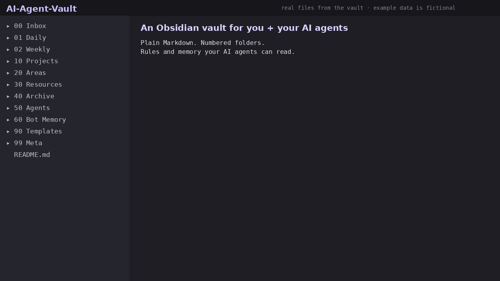

# AI Agent Vault: Lite

A free Obsidian starter vault for working with AI agents (Claude Code, Claude Desktop, ChatGPT, Grok, local models). It's plain Markdown with no plugins required.



## What's inside
```
50 Agents/AGENTS.md        universal rules every agent reads first
50 Agents/CLAUDE.md        copy to the vault root for Claude Code
50 Agents/Prompts/         Summarise Note, Extract Memory, Inbox Triage Quick
60 Bot Memory/             memory layout and entry formats (README, Profile, Session Log)
90 Templates/              Daily Note, Weekly Review, Inbox Capture
99 Meta/Conventions.md     naming, frontmatter, tags
00 Inbox/ 01 Daily/ 10 Projects/
.obsidian/                 daily notes and templates already configured
```

## Quick start
1. Clone or download this repo and open the folder in Obsidian ("Open folder as vault").
2. Fill in `60 Bot Memory/Profile.md` with your own preferences.
3. **Claude Code:** copy `50 Agents/CLAUDE.md` to the vault root, then run `claude` in the folder.
4. **Chat assistants:** paste `AGENTS.md`, `Profile.md` and your current note into the chat.

## Core rules (from AGENTS.md)
- Agents write new notes to `00 Inbox/` with frontmatter (`type`, `created`, `tags`, `source: agent`).
- Agents append to memory and never rewrite or delete it.
- Agents never store secrets, ID numbers, health or financial data, or details about other people.
- Every session ends with an entry in `Session Log.md`.

## Full version
The full kit ($19) adds 12 prompts, 4 agent runbooks, the complete memory system (Facts, Decisions, Active Context, Glossary), 10 templates, a Dataview dashboard, and a 25-page setup guide covering Claude Code, Claude Desktop through MCP, and ChatGPT/Grok:
https://aimeowin.gumroad.com/l/ouzhcp

The lite version is also on Gumroad: https://aimeowin.gumroad.com/l/bjaxq

## Notes
- All example data is fictional.
- Nothing in this vault connects to the internet. Your notes only go where you send them.
- License: MIT (see LICENSE).
- `VAULT-README.md` is the in-vault README; delete it or keep it as your vault map.
